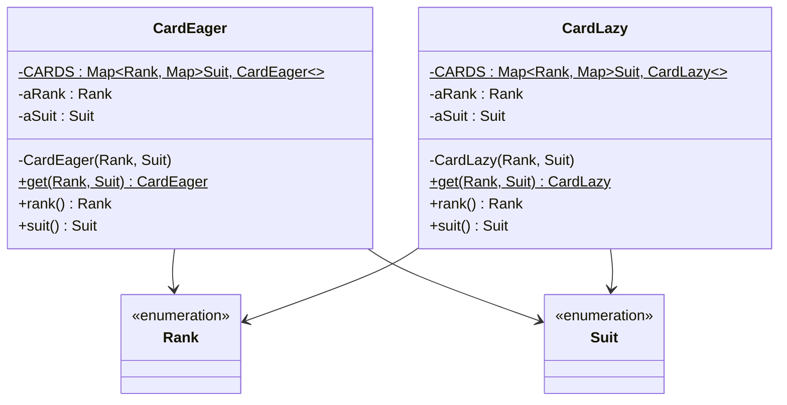

# Lab 05: Exercise 8 - Flyweight khởi tạo muộn

| | |
|---|---|
| **Họ và tên** | Huỳnh Ngọc Khang |
| **MSSV** | 4651050116 |
| **Lớp** | CNTT46D |
| **Bài** | Lab 05 - Exercise 8 |

---

## 1. Đề bài

Exercise 8 yêu cầu sửa Flyweight của lá bài để mỗi lá chỉ được tạo khi cần. Bài cũng yêu cầu đo thời gian lấy đủ 52 lá rồi so sánh với cách khởi tạo sẵn.

## 2. Giải pháp

Em cài hai lớp dùng chung ý tưởng Flyweight, nhưng tạo lá ở thời điểm khác nhau:

| Lớp | Cách tạo | Thời điểm tạo 52 lá |
|---|---|---|
| `CardEager` | Khởi tạo sẵn | Khi lớp được nạp, trong khối `static` |
| `CardLazy` | Khởi tạo muộn | Tạo từng lá khi `get(rank, suit)` được gọi lần đầu |

Hai lớp dùng `IdentityHashMap` lồng nhau để lưu flyweight theo `Rank` và `Suit`.



Mã nguồn của hai cách tạo lá và chương trình chạy nằm ở [CardEager.java](src/lab05/CardEager.java), [CardLazy.java](src/lab05/CardLazy.java) và [Main.java](src/lab05/Main.java).

## 3. Chương trình đo thời gian

`Main` in số lá dựa trên số giá trị của hai enum. `measureCards` dùng chung phần bấm giờ; `getAllLazyCards` và `getAllEagerCards` mỗi hàm duyệt rank và suit rồi gọi lớp tương ứng. Thời gian được in theo ms từ `System.currentTimeMillis()` và µs từ `System.nanoTime()`.

Chạy project bằng Java 25:

```sh
javac --release 25 -d bin src/e3/chapter3/*.java src/lab05/*.java
java -cp bin lab05.Main
```

## 4. Kết quả

Bảng dưới ghi lại 8 lần chạy riêng của `Main`. Mỗi lần, chương trình đo lazy trước rồi eager. Trung bình và trung vị được tính từ các số µs, sau đó làm tròn đến số nguyên gần nhất.

| Lần | Thứ tự chạy | Eager | Lazy |
|:---:|---|---:|---:|
| 1 | lazy → eager | 864 µs (1 ms) | 1,330 µs (2 ms) |
| 2 | lazy → eager | 444 µs (1 ms) | 600 µs (1 ms) |
| 3 | lazy → eager | 450 µs (0 ms) | 692 µs (1 ms) |
| 4 | lazy → eager | 424 µs (1 ms) | 626 µs (0 ms) |
| 5 | lazy → eager | 471 µs (1 ms) | 781 µs (1 ms) |
| 6 | lazy → eager | 585 µs (0 ms) | 805 µs (1 ms) |
| 7 | lazy → eager | 423 µs (0 ms) | 684 µs (1 ms) |
| 8 | lazy → eager | 423 µs (0 ms) | 782 µs (1 ms) |
| | **Trung bình** | **511 µs** | **788 µs** |
| | **Trung vị** | **447 µs** | **737 µs** |

Một lượt chạy `Main` trên JVM 25.0.2 cho kết quả:

```text
Khởi động: 52 lá
Khởi tạo muộn (lazy): 52 lá, 2 ms (1330 µs)
Khởi tạo sẵn (eager): 52 lá, 1 ms (864 µs)
```

## 5. Nhận xét và kết luận

Trong tám lượt đã chạy, eager có thời gian thấp hơn lazy. Tuy nhiên, `Main` luôn đo lazy trước, rồi eager, nên thứ tự và trạng thái JVM có thể ảnh hưởng kết quả.

Trong mỗi tiến trình, lazy tạo các lá khi vòng lặp yêu cầu chúng; eager tạo sẵn 52 lá khi lớp được nạp lần đầu. Bảng này cho thấy thời gian của eager thấp hơn trên máy chạy thử. Nếu chương trình chỉ dùng một phần bộ bài, lazy có thể tránh tạo những lá không cần đến.

Mỗi lượt đo rất ngắn nên kết quả còn thay đổi theo JVM và tải máy. `currentTimeMillis()` chỉ có độ phân giải đến ms, vì vậy số ms có thể không khớp chính xác với số µs. Các số liệu này chỉ để tham khảo.

## 6. Cấu trúc project

```text
Lab05
├── src
│   ├── e3/chapter3
│   │   ├── Rank.java
│   │   └── Suit.java
│   └── lab05
│       ├── CardEager.java
│       ├── CardLazy.java
│       └── Main.java
└── README.md
```

## Tham khảo

- [Đề bài Exercise 8](https://github.com/prmr/DesignBook/blob/master/exercises/e-chapter4.md).

Nguồn `Rank` và `Suit`: Hai file thuộc package `e3.chapter3` được sử dụng trực tiếp từ mã nguồn của cuốn sách *Introduction to Software Design with Java* do Martin P. Robillard biên soạn. Mã nguồn được công khai trên GitHub tại https://github.com/prmr/DesignBook, trong thư mục `code-e3/e3/chapter3`.
