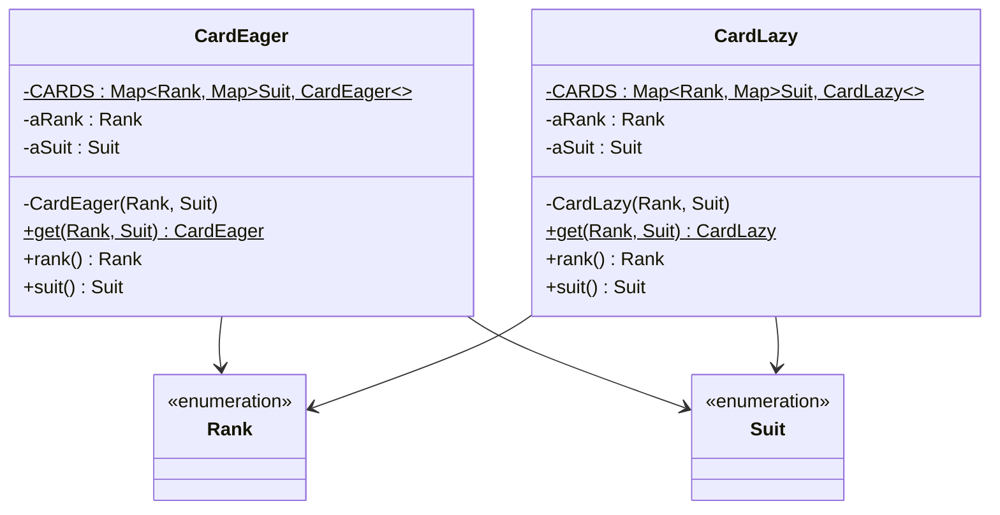

# Lab 05: Exercise 8 - Flyweight khởi tạo muộn

| | |
|---|---|
| **Họ và tên** | Huỳnh Ngọc Khang |
| **MSSV** | 4651050116 |
| **Lớp** | CNTT46D |
| **Bài** | Lab 05 - Exercise 8 |

---

## 1. Đề bài

Exercise 8 yêu cầu điều chỉnh Flyweight của lá bài để từng lá chỉ được tạo khi có yêu cầu. Sau đó, đo thời gian lấy đủ 52 lá và so sánh với cách tạo sẵn.

## 2. Giải pháp

Trong bài có hai lớp theo mẫu Flyweight. Điểm khác nhau là lúc chúng tạo các lá:

| Lớp | Cách tạo | Thời điểm tạo 52 lá |
|---|---|---|
| `CardEager` | Khởi tạo sẵn | Khi lớp được nạp, trong khối `static` |
| `CardLazy` | Khởi tạo muộn | Tạo từng lá khi `get(rank, suit)` được gọi lần đầu |

Các lá được lưu trong hai tầng `IdentityHashMap`: tầng ngoài tra theo `Rank`, tầng trong tra theo `Suit`.



Phần cài đặt nằm trong [CardEager.java](src/lab05/CardEager.java), [CardLazy.java](src/lab05/CardLazy.java) và [Main.java](src/lab05/Main.java).

## 3. Chương trình đo thời gian

`Main` lấy số lượng giá trị trong hai enum để in dòng warm-up. Khi đo, `measureCards` dùng cùng một vòng lặp để duyệt 13 rank và 4 suit cho mỗi cách tạo bài. Kết quả có ms từ `System.currentTimeMillis()` và µs từ `System.nanoTime()`.

Chạy project bằng Java 25:

```sh
javac --release 25 -d bin src/e3/chapter3/*.java src/lab05/*.java
java -cp bin lab05.Main
```

## 4. Kết quả

Bảng ghi lại tám lần chạy riêng của `Main`. Trong mỗi lần, lazy được đo trước eager. Trung bình và trung vị được tính từ số µs rồi làm tròn đến số nguyên gần nhất.

| Lần | Thứ tự chạy | Eager | Lazy |
|:---:|---|---:|---:|
| 1 | lazy → eager | 52 µs (0 ms) | 136 µs (0 ms) |
| 2 | lazy → eager | 55 µs (0 ms) | 135 µs (0 ms) |
| 3 | lazy → eager | 53 µs (0 ms) | 128 µs (0 ms) |
| 4 | lazy → eager | 54 µs (0 ms) | 147 µs (1 ms) |
| 5 | lazy → eager | 51 µs (1 ms) | 138 µs (0 ms) |
| 6 | lazy → eager | 52 µs (0 ms) | 141 µs (0 ms) |
| 7 | lazy → eager | 52 µs (0 ms) | 139 µs (0 ms) |
| 8 | lazy → eager | 49 µs (0 ms) | 147 µs (0 ms) |
| | **Trung bình** | **52 µs** | **139 µs** |
| | **Trung vị** | **52 µs** | **139 µs** |

Một lượt chạy `Main` trên JVM 25.0.2 cho kết quả:

```text
Warm-up (bỏ qua): 52 lá
Khởi tạo muộn (lazy): 52 lá, 0 ms (136 µs)
Khởi tạo sẵn (eager): 52 lá, 0 ms (52 µs)
```

## 5. Nhận xét và kết luận

Trong tám lượt đo, eager nhanh hơn lazy ở cả tám lần. Thời gian trung bình và trung vị của eager đều là 52 µs; của lazy đều là 139 µs. Kết quả này phản ánh cách cài đặt và môi trường đo hiện tại, không chứng minh eager luôn nhanh hơn trong mọi trường hợp.

Lazy tốn thời gian hơn trong phép thử này vì mỗi lần gọi còn kiểm tra kho flyweight. `CardLazy.get()` dùng `getOrDefault(pRank, new IdentityHashMap<>())`, `putIfAbsent`, `containsKey` và `get`; biểu thức tạo map mặc định cũng được tính mỗi lần gọi, dù rank đã có map con. Trong khi đó, `CardEager.get()` chỉ tra map ngoài và map con. Khi cần đủ cả 52 lá, eager tạo chúng một lần lúc lớp được nạp; lazy cũng phải tạo đủ 52 lá, nhưng thực hiện việc đó trong các lần gọi `get()`.

Lazy vẫn có ích nếu chương trình chỉ cần một phần bộ bài hoặc việc tạo mỗi đối tượng tốn kém. Bài đo này luôn lấy đủ 52 lá nên không thể hiện lợi thế đó. Các map trong `CardLazy` cũng không đồng bộ; nếu nhiều luồng cùng yêu cầu một lá chưa có, chúng có thể tạo nhiều đối tượng cho cùng một rank/suit. Cách cài đặt hiện tại phù hợp với bài thực hành đơn luồng.

Kết quả còn chịu ảnh hưởng của phép đo: `Main` luôn chạy lazy trước eager, và thời gian mỗi lượt rất ngắn. `currentTimeMillis()` có độ phân giải đến ms, trong khi µs lấy từ `nanoTime()`. Vì vậy bảng chỉ nên dùng để nhận xét các lượt chạy này; đổi thứ tự, JVM hoặc tải máy có thể làm số đo thay đổi.

## 6. Cấu trúc project

```text
Lab05
├── src
│   ├── e3/chapter3
│   │   ├── Rank.java
│   │   └── Suit.java
│   └── lab05
│       ├── CardEager.java
│       ├── CardLazy.java
│       └── Main.java
└── README.md
```

## Tham khảo

- [Đề bài Exercise 8](https://github.com/prmr/DesignBook/blob/master/exercises/e-chapter4.md).

Nguồn `Rank` và `Suit`: Hai file thuộc package `e3.chapter3` được sử dụng trực tiếp từ mã nguồn của cuốn sách *Introduction to Software Design with Java* do Martin P. Robillard biên soạn. Mã nguồn được công khai trên GitHub tại https://github.com/prmr/DesignBook, trong thư mục `code-e3/e3/chapter3`.
