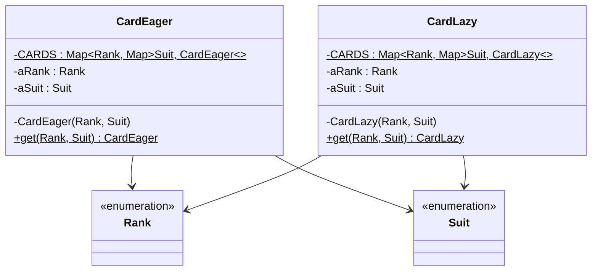

# Lab 05: Exercise 8 - Flyweight khởi tạo muộn

| | |
|---|---|
| **Họ và tên** | Huỳnh Ngọc Khang |
| **MSSV** | 4651050116 |
| **Lớp** | CNTT46D |
| **Bài** | Lab 05 - Exercise 8, Chapter 4 |

---

## 1. Đề bài

Exercise 8 yêu cầu sửa Flyweight của lá bài để mỗi lá chỉ được tạo khi cần. Bài cũng yêu cầu đo thời gian lấy đủ 52 lá rồi so sánh với cách khởi tạo sẵn.

## 2. Giải pháp

Em cài hai lớp dùng chung ý tưởng Flyweight, nhưng tạo lá ở thời điểm khác nhau:

| Lớp | Cách tạo | Thời điểm tạo 52 lá |
|---|---|---|
| `CardEager` | Khởi tạo sẵn | Khi lớp được nạp, trong khối `static` |
| `CardLazy` | Khởi tạo muộn | Tạo từng lá khi `get(rank, suit)` được gọi lần đầu |

Em dùng `EnumMap` lồng nhau để lưu các lá. Khóa của từng map là `Rank` hoặc `Suit`, đều là enum.



Mã nguồn của hai cách tạo lá và chương trình chạy nằm ở [CardEager.java](src/lab05/CardEager.java), [CardLazy.java](src/lab05/CardLazy.java) và [Main.java](src/lab05/Main.java).

## 3. Chương trình đo thời gian

`Main` duyệt các enum một lượt warm-up, rồi lấy đủ các tổ hợp `Rank` và `Suit` cho từng cách. Có 13 rank và 4 suit, nên mỗi lượt lấy 52 lá. Kết quả được in theo ms từ `System.currentTimeMillis()` và µs từ `System.nanoTime()`.

Chạy project bằng Java 25:

```sh
javac --release 25 -d bin src/e3/chapter3/*.java src/lab05/*.java
java -cp bin lab05.Main
```

## 4. Kết quả

Bảng ghi lại 8 lượt đo. Năm lượt đầu chạy eager trước, ba lượt sau đổi sang lazy trước. `Main` chỉ thực hiện một lượt cho mỗi cách; trung bình và trung vị trong bảng được tính riêng, rồi làm tròn đến µs gần nhất.

| Lần | Thứ tự chạy | Eager | Lazy |
|:---:|---|---:|---:|
| 1 | eager → lazy | 226 µs (0 ms) | 494 µs (1 ms) |
| 2 | eager → lazy | 174 µs (0 ms) | 497 µs (1 ms) |
| 3 | eager → lazy | 280 µs (0 ms) | 1,691 µs (2 ms) |
| 4 | eager → lazy | 261 µs (0 ms) | 903 µs (1 ms) |
| 5 | eager → lazy | 275 µs (0 ms) | 284 µs (0 ms) |
| 6 | lazy → eager | 329 µs (1 ms) | 406 µs (0 ms) |
| 7 | lazy → eager | 191 µs (0 ms) | 398 µs (0 ms) |
| 8 | lazy → eager | 262 µs (0 ms) | 460 µs (0 ms) |
| | **Trung bình** | **250 µs** | **642 µs** |
| | **Trung vị** | **262 µs** | **477 µs** |

Một lượt chạy `Main` trên JVM 25.0.2 cho kết quả:

```text
Warm-up (bỏ qua): 52 lá
Lazy: 52 lá, 1 ms (1661 µs)
Eager: 52 lá, 1 ms (622 µs)
```

## 5. Nhận xét và kết luận

Trong tám lượt ở bảng, eager có thời gian thấp hơn lazy mỗi lần. Điều này vẫn đúng ở ba lượt chạy lazy trước.

Lượt lazy 1,691 µs kéo trung bình lên 642 µs. Trung vị 477 µs ít bị ảnh hưởng bởi lượt cao bất thường hơn. Với eager, 52 lá đã có sẵn khi lớp được nạp. Lazy tạo lá theo yêu cầu; nếu chương trình cần cả bộ bài thì cuối cùng vẫn tạo đủ 52 lá. Cách lazy phù hợp hơn khi chỉ dùng một phần lá hoặc khi tạo mỗi đối tượng tốn kém.

Mỗi lượt đo rất ngắn nên kết quả còn thay đổi theo JVM và tải máy. `currentTimeMillis()` chỉ có độ phân giải đến ms, vì vậy nhiều lượt hiện 0 ms dù số µs khác 0. Các số liệu này chỉ để tham khảo.

## 6. Cấu trúc project

```text
Lab05
├── src
│   ├── e3/chapter3
│   │   ├── Rank.java
│   │   └── Suit.java
│   └── lab05
│       ├── CardEager.java
│       ├── CardLazy.java
│       └── Main.java
└── README.md
```

## Tham khảo

- [Đề bài Exercise 8](https://github.com/prmr/DesignBook/blob/master/exercises/e-chapter4.md).

Nguồn `Rank` và `Suit`: Hai file thuộc package `e3.chapter3` được sử dụng trực tiếp từ mã nguồn của cuốn sách *Introduction to Software Design with Java* do Martin P. Robillard biên soạn. Mã nguồn được công khai trên GitHub tại https://github.com/prmr/DesignBook, trong thư mục `code-e3/e3/chapter3`.
