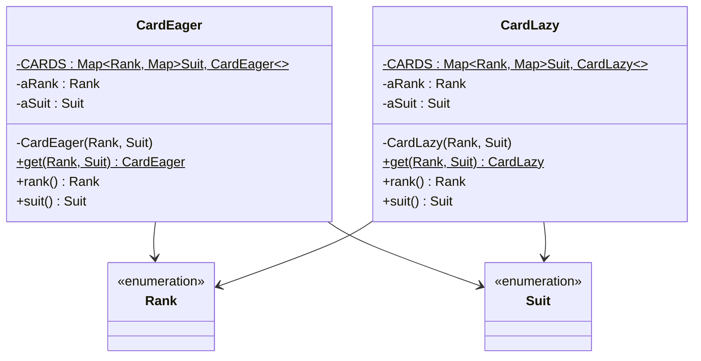

# Lab 05: Exercise 8 - Flyweight khởi tạo muộn

| | |
|---|---|
| **Họ và tên** | Huỳnh Ngọc Khang |
| **MSSV** | 4651050116 |
| **Lớp** | CNTT46D |
| **Bài** | Lab 05 - Exercise 8 |

---

## 1. Đề bài

Exercise 8 yêu cầu sửa Flyweight của lá bài để mỗi lá chỉ được tạo khi cần. Bài cũng yêu cầu đo thời gian lấy đủ 52 lá rồi so sánh với cách khởi tạo sẵn.

## 2. Giải pháp

Em cài hai lớp dùng chung ý tưởng Flyweight, nhưng tạo lá ở thời điểm khác nhau:

| Lớp | Cách tạo | Thời điểm tạo 52 lá |
|---|---|---|
| `CardEager` | Khởi tạo sẵn | Khi lớp được nạp, trong khối `static` |
| `CardLazy` | Khởi tạo muộn | Tạo từng lá khi `get(rank, suit)` được gọi lần đầu |

Hai lớp dùng `IdentityHashMap` lồng nhau để lưu flyweight theo `Rank` và `Suit`.



Mã nguồn của hai cách tạo lá và chương trình chạy nằm ở [CardEager.java](src/lab05/CardEager.java), [CardLazy.java](src/lab05/CardLazy.java) và [Main.java](src/lab05/Main.java).

## 3. Chương trình đo thời gian

`Main` lấy số lượng giá trị từ hai enum để in dòng warm-up. Sau đó, cùng một vòng lặp đi qua 13 rank và 4 suit để lấy đủ 52 lá cho mỗi cách. Thời gian được in theo ms từ `System.currentTimeMillis()` và µs từ `System.nanoTime()`.

Chạy project bằng Java 25:

```sh
javac --release 25 -d bin src/e3/chapter3/*.java src/lab05/*.java
java -cp bin lab05.Main
```

## 4. Kết quả

Bảng dưới ghi lại 8 lần chạy riêng của `Main`. Mỗi lần, chương trình đo lazy trước rồi eager. Trung bình và trung vị được tính từ các số µs, sau đó làm tròn đến số nguyên gần nhất.

| Lần | Thứ tự chạy | Eager | Lazy |
|:---:|---|---:|---:|
| 1 | lazy → eager | 52 µs (0 ms) | 136 µs (0 ms) |
| 2 | lazy → eager | 55 µs (0 ms) | 135 µs (0 ms) |
| 3 | lazy → eager | 53 µs (0 ms) | 128 µs (0 ms) |
| 4 | lazy → eager | 54 µs (0 ms) | 147 µs (1 ms) |
| 5 | lazy → eager | 51 µs (1 ms) | 138 µs (0 ms) |
| 6 | lazy → eager | 52 µs (0 ms) | 141 µs (0 ms) |
| 7 | lazy → eager | 52 µs (0 ms) | 139 µs (0 ms) |
| 8 | lazy → eager | 49 µs (0 ms) | 147 µs (0 ms) |
| | **Trung bình** | **52 µs** | **139 µs** |
| | **Trung vị** | **52 µs** | **139 µs** |

Một lượt chạy `Main` trên JVM 25.0.2 cho kết quả:

```text
Warm-up (bỏ qua): 52 lá
Khởi tạo muộn (lazy): 52 lá, 0 ms (136 µs)
Khởi tạo sẵn (eager): 52 lá, 0 ms (52 µs)
```

## 5. Nhận xét và kết luận

### Hai cách tạo flyweight

Mỗi lá bài được xác định bởi một cặp `Rank` và `Suit`. Hai lớp lưu các đối tượng theo cặp đó trong một `Map` lồng nhau: map bên ngoài tìm theo rank, map bên trong tìm theo suit. Constructor là private để chương trình lấy lá qua phương thức `get()` và dùng kho flyweight chung.

`CardEager` tạo đủ 52 lá trong khối `static`. JVM chạy khối này khi lớp được khởi tạo, thường là lần đầu chương trình gọi `CardEager.get()`. Sau đó `get()` chỉ tìm rank rồi tìm suit trong hai map.

`CardLazy` bắt đầu với map rỗng. Khi `get(rank, suit)` được gọi, lớp tìm hoặc tạo map con cho rank, kiểm tra lá theo suit, rồi chỉ tạo `CardLazy` nếu lá chưa có. Lần gọi tiếp theo lấy lại lá đã lưu. Vì chương trình yêu cầu đủ 52 tổ hợp, lazy cuối cùng cũng tạo đủ 52 đối tượng.

Trong `CardLazy`, `getOrDefault(pRank, new IdentityHashMap<>())` tạo đối số mặc định trước khi gọi `getOrDefault`; vì thế một map tạm được tạo ở mỗi lần gọi, kể cả khi rank đã có map con. Sau đó mã còn gọi `putIfAbsent`, `containsKey` và `get`. Eager chỉ gọi `get` trên hai map. Phần kiểm tra và map tạm góp phần làm lazy chậm hơn trong số đo này. `IdentityHashMap` so sánh khóa theo cùng tham chiếu; điều này phù hợp với enum vì mỗi hằng enum chỉ có một đối tượng.

### Cách đọc số đo

`Main` đi qua 13 rank và 4 suit để lấy đủ 52 lá cho mỗi cách. Dòng `Warm-up` chỉ tính số tổ hợp từ hai enum; nó không gọi `CardLazy.get()` hay `CardEager.get()`, nên không làm nóng phần tạo flyweight. Trong mỗi lượt đo, chương trình chạy lazy trước rồi eager. Mỗi lượt là một tiến trình Java mới, vì vậy các map static được tạo lại khi bắt đầu lượt tiếp theo.

`System.nanoTime()` cho số µs trong bảng chi tiết hơn. `System.currentTimeMillis()` chỉ có độ phân giải theo ms; vì vậy thời gian µs nhỏ hơn một ms có thể đi kèm giá trị `0 ms`, và hai cột thời gian đôi khi không khớp chính xác.

### Kết quả và giới hạn

Trong tám lượt ghi nhận, eager nhanh hơn lazy ở cả tám lượt. Trung bình của eager là 52 µs, trung vị 52 µs; lazy có trung bình 139 µs và trung vị 139 µs. Kết quả phù hợp với cách cài đặt hiện tại: eager trả về các lá đã tạo sẵn, còn lazy phải kiểm tra map và tạo lá khi chưa có.

Đây là kết quả của một phép đo ngắn trên máy chạy thử, không chứng minh eager luôn nhanh hơn. `Main` luôn chạy lazy trước, nên thứ tự chạy và hoạt động nền của JVM có thể ảnh hưởng kết quả. Nếu chỉ dùng một phần nhỏ bộ bài, lazy vẫn có thể tiết kiệm việc tạo các lá không được yêu cầu; bài đo này lấy đủ 52 lá nên không thể hiện lợi ích đó.

Hai map trong `CardLazy` là `IdentityHashMap`, không đồng bộ. Nếu nhiều luồng cùng yêu cầu một lá chưa được tạo, chúng có thể đồng thời tạo các đối tượng khác nhau cho cùng một cặp rank/suit. Bản này phù hợp với bài chạy đơn luồng; dùng trong chương trình đa luồng thì cần đồng bộ hóa việc tìm và tạo flyweight.

## 6. Cấu trúc project

```text
Lab05
├── src
│   ├── e3/chapter3
│   │   ├── Rank.java
│   │   └── Suit.java
│   └── lab05
│       ├── CardEager.java
│       ├── CardLazy.java
│       └── Main.java
└── README.md
```

## Tham khảo

- [Đề bài Exercise 8](https://github.com/prmr/DesignBook/blob/master/exercises/e-chapter4.md).

Nguồn `Rank` và `Suit`: Hai file thuộc package `e3.chapter3` được sử dụng trực tiếp từ mã nguồn của cuốn sách *Introduction to Software Design with Java* do Martin P. Robillard biên soạn. Mã nguồn được công khai trên GitHub tại https://github.com/prmr/DesignBook, trong thư mục `code-e3/e3/chapter3`.
