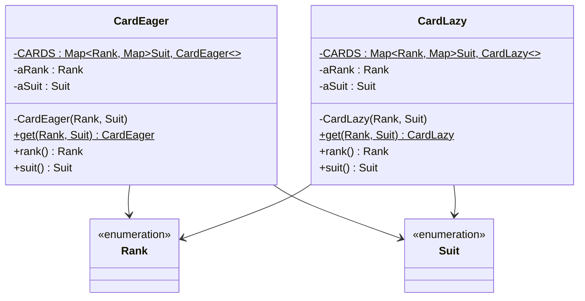

# Lab 05: Exercise 8 - Flyweight khởi tạo muộn

| | |
|---|---|
| **Họ và tên** | Huỳnh Ngọc Khang |
| **MSSV** | 4651050116 |
| **Lớp** | CNTT46D |
| **Bài** | Lab 05 - Exercise 8 |

---

## 1. Đề bài

Exercise 8 yêu cầu điều chỉnh Flyweight của lá bài để từng lá chỉ được tạo khi có yêu cầu. Sau đó, đo thời gian lấy đủ 52 lá và so sánh với cách tạo sẵn.

## 2. Giải pháp

Trong bài có hai lớp theo mẫu Flyweight. Điểm khác nhau là lúc chúng tạo các lá:

| Lớp | Cách tạo | Thời điểm tạo 52 lá |
|---|---|---|
| `CardEager` | Khởi tạo sẵn | Khi lớp được nạp, trong khối `static` |
| `CardLazy` | Khởi tạo muộn | Tạo từng lá khi `get(rank, suit)` được gọi lần đầu |

Các lá được lưu trong hai tầng `IdentityHashMap`: tầng ngoài tra theo `Rank`, tầng trong tra theo `Suit`.



Phần cài đặt nằm trong [CardEager.java](src/lab05/CardEager.java), [CardLazy.java](src/lab05/CardLazy.java) và [Main.java](src/lab05/Main.java).

## 3. Chương trình đo thời gian

`Main` lấy số lượng giá trị trong hai enum để in dòng warm-up. Khi đo, `measureCards` dùng cùng một vòng lặp để duyệt 13 rank và 4 suit cho mỗi cách tạo bài. Kết quả có ms từ `System.currentTimeMillis()` và µs từ `System.nanoTime()`.

Chạy project bằng Java 25:

```sh
javac --release 25 -d bin src/e3/chapter3/*.java src/lab05/*.java
java -cp bin lab05.Main
```

## 4. Kết quả

Bảng ghi lại tám lần chạy riêng của `Main`. Trong mỗi lần, lazy được đo trước eager. Trung bình và trung vị được tính từ số µs rồi làm tròn đến số nguyên gần nhất.

| Lần | Thứ tự chạy | Eager | Lazy |
|:---:|---|---:|---:|
| 1 | lazy → eager | 52 µs (0 ms) | 136 µs (0 ms) |
| 2 | lazy → eager | 55 µs (0 ms) | 135 µs (0 ms) |
| 3 | lazy → eager | 53 µs (0 ms) | 128 µs (0 ms) |
| 4 | lazy → eager | 54 µs (0 ms) | 147 µs (1 ms) |
| 5 | lazy → eager | 51 µs (1 ms) | 138 µs (0 ms) |
| 6 | lazy → eager | 52 µs (0 ms) | 141 µs (0 ms) |
| 7 | lazy → eager | 52 µs (0 ms) | 139 µs (0 ms) |
| 8 | lazy → eager | 49 µs (0 ms) | 147 µs (0 ms) |
| | **Trung bình** | **52 µs** | **139 µs** |
| | **Trung vị** | **52 µs** | **139 µs** |

Một lượt chạy `Main` trên JVM 25.0.2 cho kết quả:

```text
Warm-up (bỏ qua): 52 lá
Khởi tạo muộn (lazy): 52 lá, 0 ms (136 µs)
Khởi tạo sẵn (eager): 52 lá, 0 ms (52 µs)
```

## 5. Nhận xét và kết luận

### Cách tạo lá

Mỗi lá được định danh bằng `Rank` và `Suit`. Hai lớp dùng một `IdentityHashMap` ngoài để tìm theo rank, rồi một map con để tìm theo suit. Constructor private buộc chương trình tạo lá qua `get()` và dùng lại kho flyweight.

Khi `CardEager` được nạp lần đầu, khối `static` tạo đủ 52 lá và lưu chúng vào map. Những lần gọi `get()` sau chỉ tra map ngoài theo rank rồi map con theo suit.

`CardLazy` bắt đầu với map rỗng. Lần gọi `get(rank, suit)` đầu tiên tạo map con nếu rank chưa có, rồi tạo lá nếu suit đó chưa được lưu. Các lần gọi sau lấy lại lá đã có. Vì chương trình yêu cầu cả bộ bài, cuối cùng lazy cũng tạo đủ 52 đối tượng.

Trong `CardLazy`, `getOrDefault(pRank, new IdentityHashMap<>())` tạo map tạm trước mỗi lần gọi, kể cả khi rank đã có map con. Sau đó hàm còn gọi `putIfAbsent`, `containsKey` và `get`. `CardEager.get()` chỉ gọi `get()` hai lần. Những bước bổ sung này là một lý do lazy chậm hơn trong số đo hiện tại. `IdentityHashMap` so khóa bằng cùng tham chiếu; enum phù hợp với cách so sánh này vì mỗi hằng enum chỉ có một đối tượng.

### Cách đo

`Main` in số tổ hợp bằng cách nhân số giá trị của hai enum. Phần đo duyệt đủ 13 rank và 4 suit cho mỗi cách tạo lá. Dòng `Warm-up` chỉ đếm số tổ hợp; nó không gọi hai lớp bài và không làm nóng phần tạo flyweight.

Mỗi lần chạy tạo một tiến trình Java mới. Trong từng tiến trình, lazy luôn được đo trước eager, nên thứ tự chạy và hoạt động của JVM vẫn có thể ảnh hưởng đến kết quả. `System.nanoTime()` cho số µs chi tiết hơn; `System.currentTimeMillis()` chỉ có độ phân giải ms. Vì vậy, một lượt có thể hiện `0 ms` dù thời gian tính bằng µs lớn hơn 0.

### Kết quả

Trong tám lượt ghi nhận, eager nhanh hơn lazy. Eager có trung bình 52 µs và trung vị 52 µs; lazy có trung bình 139 µs và trung vị 139 µs. Đây là kết quả của cách cài đặt hiện tại, không phải quy luật cho mọi chương trình.

Khi cần đủ 52 lá, eager tạo cả bộ bài ngay lúc lớp được nạp. Lazy tạo lá theo yêu cầu, nhưng trong bài này cuối cùng vẫn phải tạo đủ bộ. Lazy hữu ích hơn nếu chương trình thường chỉ dùng một phần bộ bài hoặc việc tạo mỗi lá tốn kém.

Hai map của `CardLazy` không đồng bộ. Nếu nhiều luồng cùng yêu cầu một lá chưa có, chúng có thể cùng tạo lá cho một cặp rank/suit. Cách cài đặt này phù hợp với bài thực hành đơn luồng; chương trình đa luồng cần đồng bộ thao tác tìm và thêm flyweight.

## 6. Cấu trúc project

```text
Lab05
├── src
│   ├── e3/chapter3
│   │   ├── Rank.java
│   │   └── Suit.java
│   └── lab05
│       ├── CardEager.java
│       ├── CardLazy.java
│       └── Main.java
└── README.md
```

## Tham khảo

- [Đề bài Exercise 8](https://github.com/prmr/DesignBook/blob/master/exercises/e-chapter4.md).

Nguồn `Rank` và `Suit`: Hai file thuộc package `e3.chapter3` được sử dụng trực tiếp từ mã nguồn của cuốn sách *Introduction to Software Design with Java* do Martin P. Robillard biên soạn. Mã nguồn được công khai trên GitHub tại https://github.com/prmr/DesignBook, trong thư mục `code-e3/e3/chapter3`.
